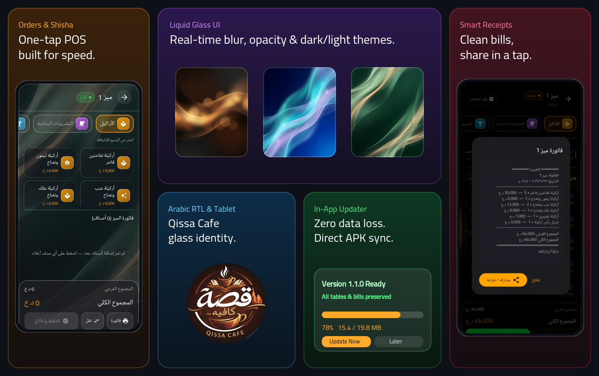

# • كافتيريا • 

  
  
  
  

**إدارة الكافتيريا والمقاهي، بإحساس زجاجي فاخر. مصمم للسرعة. سلس بطبعه.**

**نظام نقاط بيع (POS) متكامل للأندرويد والتابلت:** إدارة مباشرة للطاولات والأراكيل والمشروبات،  
بواجهة زجاجية مستوحاة من iOS مع دعم كامل للغة العربية (RTL) وبدون أي تعقيد.

بلا إعلانات. بلا اشتراكات. واجهة زجاجية بضبابية فورية، فواتير ضيافة أنيقة، وتحديثات مباشرة من داخل التطبيق دون حذف أي بيانات.

**تجربة عصرية لإدارة الكافتيريا.**

 

  

 

## التحميل المباشر (Download)

- **صفحة التحميل الرسمية:** [k9rde.github.io/Cafeteria](https://k9rde.github.io/Cafeteria/)
- **رابط التحميل المباشر للـ APK:** [Cafeteria-POS.apk (الإصدار 1.1.0)](https://github.com/k9rde/Cafeteria/releases/download/latest/Cafeteria-POS.apk)

> يدعم التطبيق **التحديث المباشر من الداخل** مع شريط تقدم التحميل وخيار *«التحديث الآن»* أو *«التحديث لاحقاً»* مع الحفاظ الكامل على جميع الطاولات والفواتير والمنيو والإعدادات.

---

## أبرز المميزات (Features)

- **لوحة الطاولات الحية:** متابعة فورية لحالة كل ميز (`فارغ`، `مشغول` بمؤقت حي، `بانتظار الحساب`) مع فلاتر سريعة وإضافة وتعديل وحذف ونقل الطاولات بنقرة واحدة.
- **نظام طلبات سريع وفواتير ضيافة:** أقسام مخصصة للأراكيل والمشروبات الساخنة والباردة والحلويات مع شريط أصناف أفقي سريع، ملاحظات مخصصة، خصومات، ورسوم خدمة.
- **فاتورة بشعار قصة كافيه:** معاينة منظمة للفاتورة مع شعار الكافتيريا وجدول الأصناف وإجمالي الحساب، مع إمكانية المشاركة أو الطباعة الفورية.
- **تحكم فوري بالمظهر الزجاجي:** شرائح تحكم مباشرة بدرجة الشفافية (`Glass Opacity`)، شدة الضبابية (`Blur`)، الوضع الداكن والفاتح، و4 خلفيات زجاجية مخصصة.
- **إدارة المالك والجرد اليومي:** حماية برمز `PIN` مكون من 4 أرقام، إدارة كاملة للأقسام والأصناف، تغيير العملة المحلية، وتقرير الجرد اليومي للأكثر مبيعاً مع تصفير الوردية.
- **متجاوب للهواتف والأجهزة اللوحية:** عرض Split-Pane احترافي على التابلت، وانتقالات سلسة مخصصة للهواتف الذكية.

---

## التقنيات المستخدمة (Built With)

- **Kotlin** & **Jetpack Compose** (Material Design 3)
- **Room Database** & **Preferences DataStore** (تخزين محلي سريع وآمن)
- **Coroutines & StateFlow** (أداء سلس واستجابة فورية)
- **GitHub Actions & Pages** (بناء تلقائي للـ APK وتحديثات مباشرة داخل التطبيق)

---

## للتواصل مع المطور

  
  

